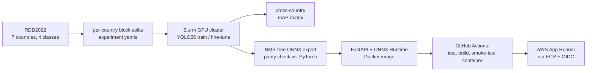

# Road damage detection, with a Norwegian focus

YOLO detector for cracks and potholes trained on RDD2022, the multi-country road damage
dataset whose Norwegian part was collected by Statens vegvesen. The experiments ask a
practical question: **how much Norwegian data does a detector need?** Deployment is a
PyTorch-free ONNX Runtime service (FastAPI, Docker) that runs on AWS App Runner, built and
deployed by GitHub Actions.



Classes: `D00` longitudinal crack, `D10` transverse crack, `D20` alligator crack, `D40` pothole.

## Experiments

| Run | Training data | Question |
|---|---|---|
| `all_yolo26s` | all countries | reference |
| `no_norway_yolo26s` | all countries except Norway | zero-shot transfer to Norwegian roads |
| `finetune_norway_{10,25,50,100}` | no-Norway model + 10-100 % of Norway | how much local data closes the gap |
| `finetune_norway_replay` | no-Norway model + all of Norway + as many photos from the other countries | a Norway model that keeps the rest |

All runs are evaluated on every country's held-out test block. RDD2022's official test labels
are not public, so each country's annotated set is split into train/val/test in contiguous
blocks of frames. That keeps neighbouring frames of the same drive on one side of the split.

**Results** (mAP50 on the held-out test blocks):

| Model | Norway | Czech | Japan | India | United States |
|---|---|---|---|---|---|
| all countries | 0.322 | **0.370** | **0.589** | **0.417** | **0.648** |
| no Norway | 0.137 | 0.388 | 0.585 | 0.423 | 0.642 |
| + 10 % Norway | 0.206 | | | | |
| + 25 % Norway | 0.214 | | | | |
| + 50 % Norway | 0.235 | | | | |
| + 100 % Norway | 0.273 | | | | |
| **+ 100 % Norway, mixed with the other countries** | **0.329** | 0.293 | 0.478 | 0.314 | 0.556 |

Norwegian roads look different from the rest of RDD2022: without Norwegian photos, the model
reaches 0.137 on Norway while the other countries barely notice (all within 0.02 of the
reference). Every share of Norwegian data helps, and the best Norway model is the mixed one: all
Norwegian training photos plus an equal number drawn from the other countries. It scores 0.329
on Norway, the highest of all runs, and keeps three quarters or more of the reference score in
every other country, so one model serves both.

## Inference

`detector.py` runs the exported model with ONNX Runtime only (no PyTorch). The model is
exported with YOLO26's end-to-end head, so the graph returns at most 300 final boxes,
`(1, 300, 6)`, and no NMS runs after it. The older layout `(1, 4 + classes, anchors)` is still
decoded with NMS, so YOLO11-style exports also work. An optional **tiled mode** helps with large
photos: Norwegian RDD photos are about 3650 × 2044 px, and thin cracks disappear when the whole
frame is shrunk to 1024 px. Overlapping tiles plus one full-frame pass are merged with
class-aware NMS (here NMS is needed, because tiles see the same damage twice).

`tests/test_yolo26_export.py` exports a real YOLO26n and checks that the ONNX graph has the
NMS-free shape, that its raw output matches PyTorch on the same input, and that the ONNX Runtime
decoding gives the same boxes as Ultralytics running the same file (5/5 boxes on `bus.jpg`,
IoU > 0.99).

```bash
pip install -e ".[serve]"
rdd-predict --model models/road_damage.onnx --source photos/ --tiles 2
RDD_MODEL=models/road_damage.onnx uvicorn road_damage.serve.app:app --port 8080
curl -F image=@road.jpg "localhost:8080/detect?tiles=2"           # JSON
curl -F image=@road.jpg localhost:8080/detect/annotated -o out.jpg # boxes drawn
```

## Why YOLO26

YOLO26 (Ultralytics, January 2026) is the newest detector family in Ultralytics 8.4. What
matters for this project is **NMS-free deployment**: the one-to-one head gives one box per
object, so the ONNX/TensorRT graph is the whole detector. There is no NMS step to re-implement
in the service, and the post-processing time does not depend on how many cracks a photo contains.

`train.py`, `evaluate.py` and `export.py` all pass `nms=False`, so `best.pt` is chosen, scored
and exported on the NMS-free head that is deployed (Ultralytics 8.4 otherwise uses the auxiliary
one-to-many head with NMS).

## Docker, CI/CD and AWS

- `Dockerfile`: python:3.11-slim + ONNX Runtime + FastAPI, a non-root user and a health check.
  No PyTorch, so the image is a few hundred MB instead of several GB.
- `ci.yml`: lint and tests. It then builds the image with a stand-in ONNX model
  (`scripts/make_dummy_model.py`), starts the container and calls `/health` and `/detect`.
- `docker-publish.yml`: on a version tag, takes `road_damage.onnx` from the GitHub release and
  pushes `ghcr.io/<owner>/road-damage-detection:<tag>`.
- `deploy-aws.yml`: manual deployment to **AWS App Runner** through ECR. It authenticates with
  GitHub OIDC (no stored AWS keys). One-time setup: `deploy/aws/create_service.sh`.

## Training on a GPU cluster (Slurm)

```bash
bash scripts/setup_cluster.sh && bash scripts/download_models.sh   # login node
bash scripts/download_rdd2022.sh                                # 13 GB, login node
python3 slurm/generate.py prepare --submit
python3 slurm/generate.py train-all --submit
python3 slurm/generate.py train-no-norway --submit
python3 slurm/generate.py finetune-norway --submit              # array, after train-no-norway
python3 slurm/generate.py eval-matrix --submit
python3 slurm/generate.py export --submit                       # ONNX + CPU latency + TensorRT FP16
```

## Project layout

```
src/road_damage/
  datasets/rdd2022.py   VOC XML -> YOLO, block splits, experiment yamls (all, no-Norway, Norway fractions, per-country test)
  train.py              resumable Ultralytics training / fine-tuning
  evaluate.py           cross-country mAP matrix
  detector.py           ONNX Runtime inference: letterbox, both output layouts, class-aware NMS, tiling
  serve/app.py          FastAPI: /health, /detect, /detect/annotated
  export.py             ONNX export + parity check; benchmark.py, predict.py
deploy/aws/             App Runner setup script and notes
tests/                  converter, detector geometry and NMS, API (stand-in ONNX model), real YOLO26 export
```

## References

- Arya et al., *RDD2022: A multi-national image dataset for automatic Road Damage Detection*, 2022 (arXiv:2209.08538; Geoscience Data Journal 2024).
- Ultralytics YOLO26, https://docs.ultralytics.com/models/yolo26.
